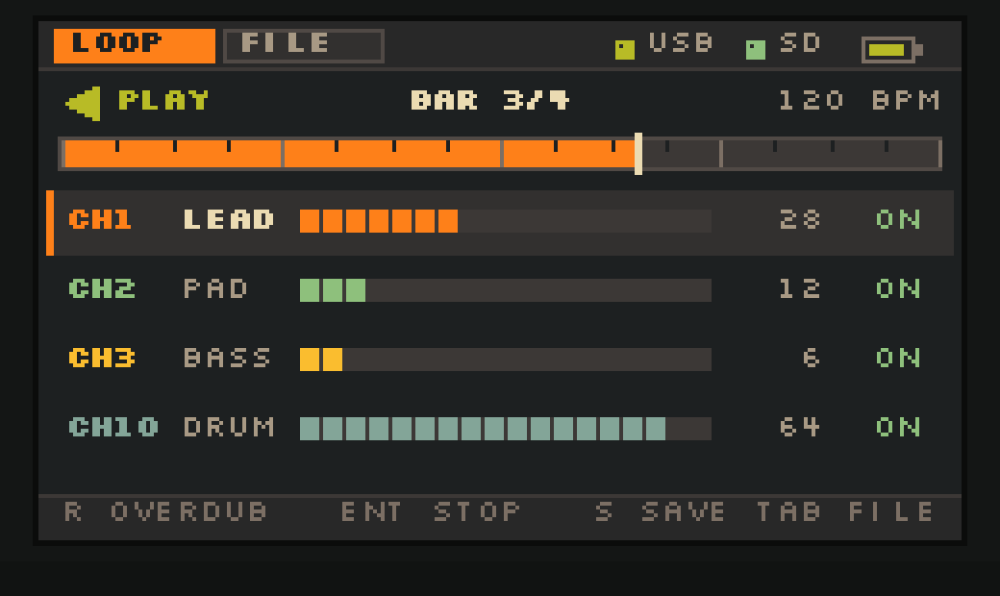
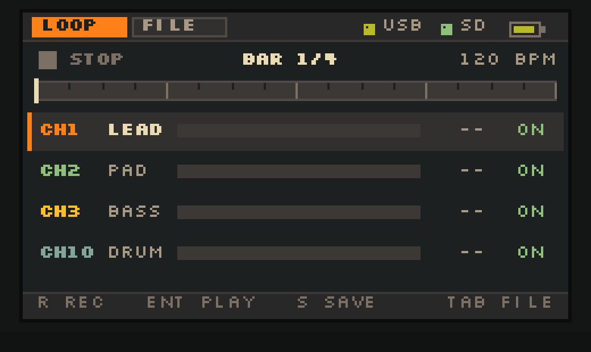
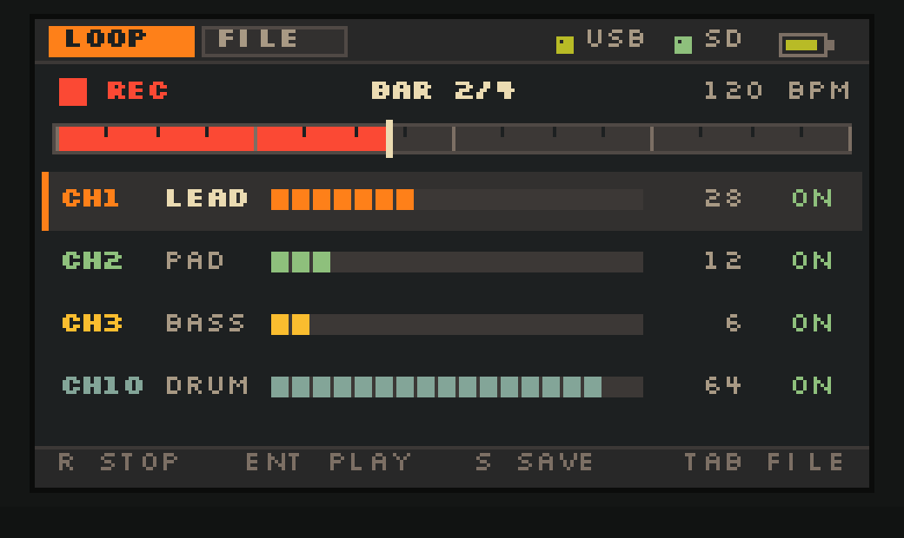
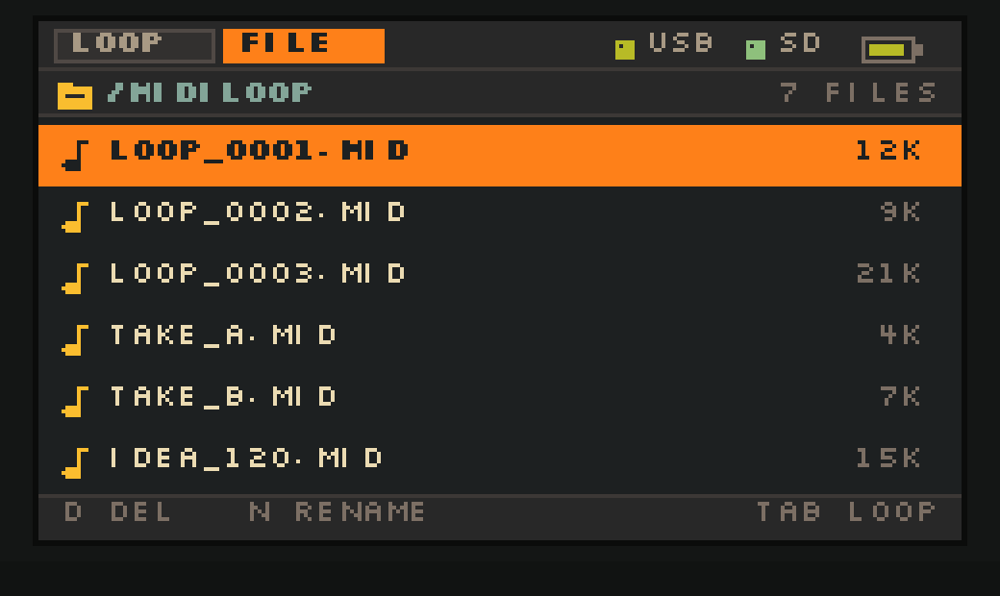
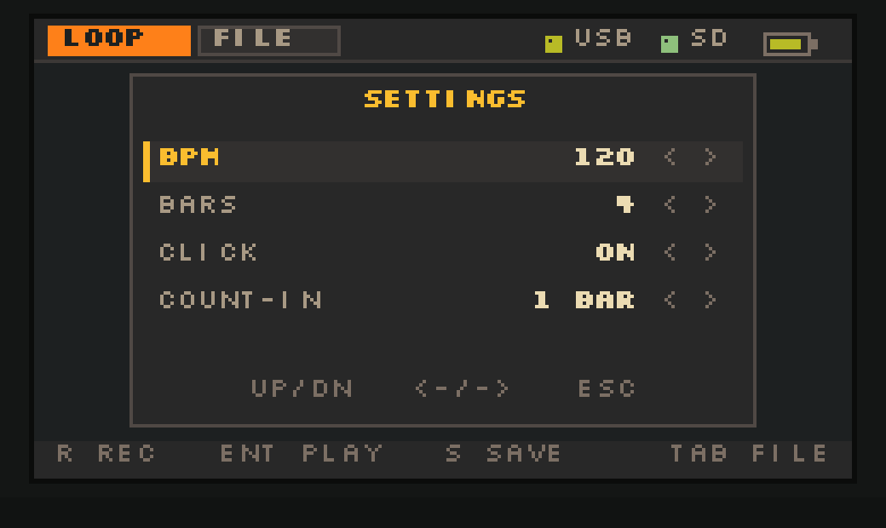
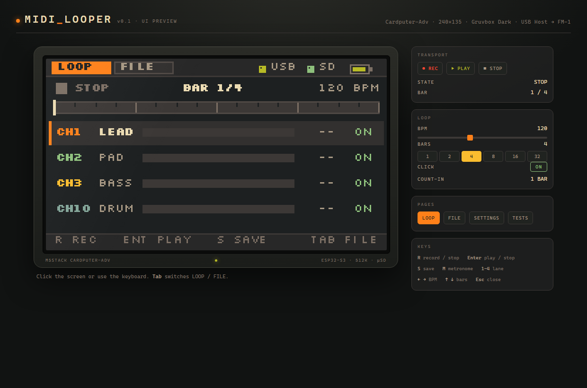
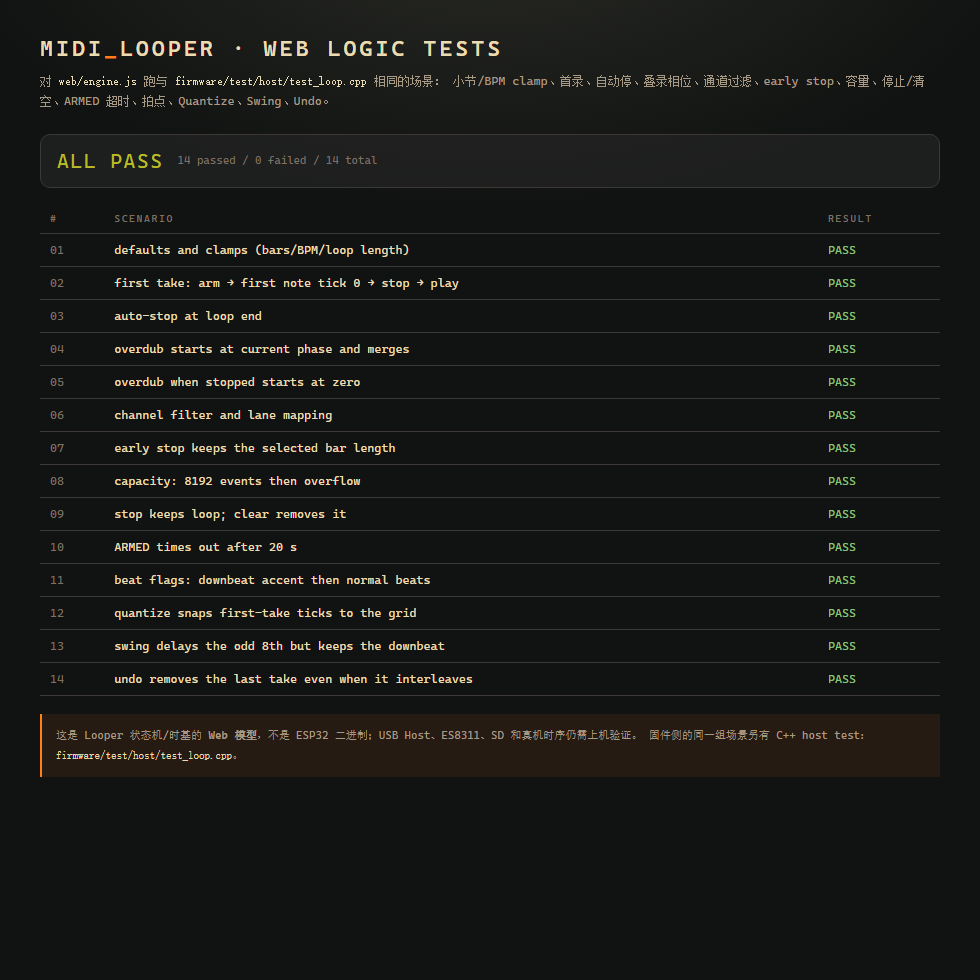

# MidiLooper — Cardputer-Adv MIDI Looper

240×135、Gruvbox Dark 的四通道 MIDI 循环叠录固件。Cardputer-Adv 作为 **USB-C Host** 直连 M-VAVE FM-1（Sloop），把 FM-1 的 CH1/2/3/10 录成循环，叠录后回放给 FM-1 发声。

> **状态**：**v1.3.1 已发布**；main 上的 **v1.3.2** 修复 Loop 模式残留导致首次录音无响应，尚未发版。  
> **Release：** <https://github.com/saxon267/Cardputer_MidiLooper/releases/tag/v1.3.1>



---

## 1. 功能

| 模块 | 说明 |
|---|---|
| USB Host | ESP32-S3 USB-OTG Host，MIDI IN + OUT 同时开；FM-1 自供电 |
| 循环 | 1/2/4/8/16/32 小节；480 PPQN；内部 BPM 40–400 |
| 叠录 | 已有循环时按 R 立即按当前相位叠录；循环继续播放 |
| Quantize | `onMidi()` 入口把 note-on / CC / PB 的 tick 吸附到网格（默认 1/16）；note-off 保留原始时长 |
| Swing | 50–75%；播放时对奇数 8 分格的事件动态加 tick 偏移，不改存储 |
| Undo | `U` 撤销最后一次叠录；按 take generation 过滤，不会误删旧事件 |
| Loop 模式 | `L` 开启即开始（无循环先 ARM，有循环直接 overdub）；`L` 关闭即结束，`R` 在 Loop 录音中作为停止/退出 |
| 单轨清空 | `Fn` + `C` 只清当前选中 lane 的 MIDI，其他 lane 保留 |
| 录制闪动 | `REC` / `OVERDUB` 时，收到音符的 lane 行随节奏闪动 |
| 文件播放 | FILE 页 `Enter` 载入 `/MidiLoop` 里的 `.mid`，按文件 tempo/bars 播放 |
| Mute | `Fn` + `1..4` 切换 CH1/2/3/10 静音；播放跳过该 lane，并 allNotesOff 防挂音 |
| 通道 | CH1 LEAD / CH2 PAD / CH3 BASS / CH10 DRUM，四 lane 同长度 |
| 节拍器 | 本地 I2S click（2 kHz 重音 / 1.35 kHz 普通）；录音/播放可开关；首录可选 4 拍 count-in |
| 走带 | Enter 播放/停止；停止时 panic（显式 Note Off + CC64/121/123/120） |
| 保存 | `S` → `/MidiLoop/LOOP_xxxx.MID`，SMF Format 0、480 PPQN、EOT 在循环末尾 |
| 文件管理 | `FILE` 页删除 / 改名；只显示 `.mid` / `.midi` |
| 设置 | BPM、小节、Quantize、Swing、click、count-in；NVS 保存 |
| UI | 两个标签页 LOOP / FILE + 设置浮层；240×135 sprite；启动页显示 `v1.3.2` 并停留 1.5 s |

事件类型：Note On/Off、CC64 延音、CC1 调制、Pitch Bend。**不发送** Program Change。

---

## 2. 快速开始

### 2.1 先看 UI（不用刷机）

双击 **`web/index.html`**，或拖进浏览器。左侧是 240×135 的 1:1 画布（3× 放大），右侧是走带 / BPM / 小节 / 节拍器控制；键盘 `R`、`Enter`、`Tab`、`S`、`M`、`1–4`、方向键都能用。右侧 `TESTS` 按钮打开逻辑自检页。

> 模拟器是 UI 的交互预览，不是固件二进制；版式常量与 `firmware/src/ui.cpp` 一一对应。录音时的数据来自 `web/engine.js`（与 `loop.cpp` 同一套状态机/时基契约），不是随机数。

### 2.2 编译 / 烧写

```bash
cd firmware
pio run                 # 编译
pio run -t upload       # USB-C 烧写（需要先断开 FM-1）
```

依赖：PlatformIO + `espressif32@6.9.0`；`M5Unified 0.3.0`、`M5GFX 0.3.0`、`M5Cardputer 1.1.1`。

### 2.3 合并镜像（从 0x0 烧写）

```bash
pwsh tools/make_bin.ps1
# dist/CardputerLooper-8MB.bin
esptool.py --chip esp32s3 -p COMx -b 460800 write_flash 0x0 dist/CardputerLooper-8MB.bin
```

**刷写顺序**：断开 FM-1 → Cardputer 接 PC → 进下载模式 → 烧写 → 拔掉 PC 的 USB-C → 断电重开 → 再接 FM-1。Host build 没有 USB-CDC 串口，调试看屏幕；不要同时把 Cardputer 接到 PC 和 FM-1。

---

## 3. 界面

| LOOP 空闲 | LOOP 录制 | FILE |
|---|---|---|
|  |  |  |

| 设置浮层 | 完整预览页 |
|---|---|
|  |  |

顶栏：`LOOP` / `FILE` 标签、USB 状态（红=Host 失败，黄=已枚举无 MIDI OUT，灰=未识别 FM-1，绿=已连接）、SD、电量。

LOOP 页：走带状态、`BAR n/N`、BPM、循环进度/拍点、四 lane 计数与 18 格电平、底部按键提示。

FILE 页：`/MIDILOOP` 路径、文件数、6 行列表（文件名 + 大小），选中行反色。

设置浮层：BPM / BARS / QUANT / SWING / CLICK / COUNT-IN，`;` / `.` 选行，`,` / `/` 改值，`Bksp` / `G` / `Tab` 关闭。

### 3.1 Web 逻辑自检

[web/test.html](<web/test.html>) 直接跑 **18 个场景**：小节/BPM clamp、首录、自动停、叠录相位、从停止叠录、通道过滤、early stop、8192 容量、停止/清空、ARMED 超时、拍点、Quantize、Swing、Undo、Mute、文件载入、单轨清空、Loop 模式。当前结果 **ALL PASS**。



也可以在 PC 上无浏览器跑同一套：

```bash
node web/test/run-node.js
# RESULT OK
```

`pwsh tools/web-smoke.ps1` 会启动 headless Edge，通过 CDP 真实点击/按键走一遍交互流程（count-in → REC → 自动停 → MUTE → OVERDUB → UNDO → SAVE → CLEAR → early stop → BARS 保护 → LOOP MODE），当前 **24 项检查全通过**。

> 这验证的是 Web 模型（`web/engine.js`）与 UI 交互契约；固件侧的 C++ 实现对同一组场景另有 host test（第 9 节）。两者都通过；USB、ES8311、SD 等硬件行为仍以真机为准。

---

## 4. 固件按键

### LOOP 页

| 键 | 动作 |
|---|---|
| `R` / `Space` | 录音 / 停止录音；已有循环时进入叠录 |
| `Enter` | 播放 / 停止 |
| `S` | 保存为 `/MidiLoop/LOOP_xxxx.MID`（会先停止播放） |
| `C` | 清空整个 loop（所有 lane，**不删除** `.mid` 文件） |
| `Fn` + `C` | 只清空当前选中的 lane（CH1/2/3/10） |
| `U` | 撤销最后一次叠录（叠录中按 U 取消当前 take） |
| `L` | Loop 模式开 / 关；开启即开始录音，关闭即结束 |
| `Fn` + `1` / `2` / `3` / `4` | Mute / Unmute CH1 / CH2 / CH3 / CH10 |
| `M` | 节拍器开 / 关 |
| `G` | 打开设置浮层 |
| `Tab` | 切到 FILE |
| `1` / `2` / `3` / `4` | 选中 CH1 / CH2 / CH3 / CH10 lane |
| `,` / `/` | BPM −1 / +1 |
| `Fn` + `,` / `/` | BPM −5 / +5 |
| `;` / `.` | 上 / 下选择 lane |
| `Fn` + `;` / `.` | 小节数 + / −（1/2/4/8/16/32） |
| `-` / `=` | BPM −1 / +1 |
| `Bksp` | 停止（停止录音时保留已录内容） |

### FILE 页

| 键 | 动作 |
|---|---|
| `;` / `.` | 上 / 下选择文件 |
| `D` | 删除（`Enter` 确认，`Bksp` / `D` 取消） |
| `N` | 改名（直接键入；`Enter` 确认，`Bksp` 退格，`Tab` 取消） |
| `Enter` | 载入选中的 `.mid` 并播放（按文件 tempo/bars） |
| `Tab` / `Bksp` | 回到 LOOP |

### 设置浮层

| 键 | 动作 |
|---|---|
| `;` / `.` | 选行 |
| `,` / `/` | 改值（BPM ±5、BARS 切换、QUANT 切换、SWING ±5、CLICK/COUNT-IN 开关） |
| `Enter` | 开关当前项；BPM/BARS/QUANT/SWING 行关闭浮层；CLICK/COUNT-IN 切换 |
| `Bksp` / `G` / `Tab` | 关闭 |

---

## 5. 循环行为（固件契约）

这是 v0.1 真正实现的行为，和 UI 提示一致：

1. **长度由小节数决定**：`loopLen = bars × 4 × 480` ticks（4/4、480 PPQN）。32 小节 = 61,440 ticks。
2. **第一次录音**：按 `R` → `ARMED`。若开启 count-in，先响 4 拍 click；收到第一个 CH1/2/3/10 音符 → 从 tick 0 开始录。
3. **录满自动停**：到 `loopLen` 自动结束并进入 `PLAY`。提前按 `R` 会收尾，但**保持小节数不变**，尾部补静音。
4. **叠录**：已有循环且 `PLAY` 时按 `R` → 立即按当前相位叠录（事件 tick 对 `loopLen` 取模）；再按 `R` 结束；到循环末尾自动结束。循环继续播放，不需要等首音或等循环边界。
5. **播放/停止**：`Enter`。停止时按活动音符表发 Note Off，再补 CC64/121/123/120。
6. **保存**：`S` 先停止，再写 `/MidiLoop/LOOP_xxxx.MID`；EOT 落在 `loopLen`，不是最后一个事件。
7. **改长度**：必须先 `C` 清空；有循环时改 BARS 会提示 `CLEAR FIRST`。
8. **录音中禁改 BPM**：避免已录事件的时间戳跳变。
9. **Quantize**：默认 `1/16`（120 ticks），只吸附 note-on / CC / PB；note-off 不吸附，保持音符原始时长。如果 note-off 落到对应 note-on 之前，会 clamp 到 on+1 tick，避免零长度/挂音。首音 tick 0 不变。
10. **Swing**：默认 50（直拍）；50–75% 时只对奇数 8 分格的事件在发送前加偏移（66% ≈ 76 ticks），存储的 tick 不变，保存的 MIDI 也是直拍。
11. **Undo**：每次进入叠录取一个 take generation；`U` 过滤掉该 generation 的事件。因为叠录是排序合并，不能简单按数量截断，否则会误删旧事件。
12. **文件播放**：FILE 页 `Enter` 读取 SMF（Format 0/1、480 PPQN 转换、tempo、EOT），载入 inactive buffer 后提交并播放；`C` 只清 RAM 轨道，`.mid` 文件保留。
13. **Mute**：`Fn` + `1..4` 切换；pump 跳过该 lane 的事件，并在静音瞬间对该通道发 `allNotesOff`，避免正在响的音挂住。Mute 只影响回放，保存仍包含全部事件。
14. **Loop 模式**：`L` 开关。按 `L` 开启：没有循环直接 `ARMED`（有 count-in 就倒计时），已有循环直接进入 overdub，**不需要按 `R`**；之后每到循环末尾自动续录。再按 `L` 关闭会结束当前 take。Loop 模式 `ARMED` 时按 `R` 只提示 `PLAY A NOTE`，不会取消等待首音；Loop 模式 `REC` 时按 `R` 关闭 Loop 模式并停止当前 take。启动时如果没有已存在的 loop，Loop 模式不会从 NVS 恢复，避免残留状态导致“按了没反应”。
15. **录制闪动**：`REC` / `OVERDUB` 中收到 note-on 时，对应 lane 行闪 90 ms；UI 以 30 fps 渲染，闪动跟随输入音符的节奏。
16. **单轨清空**：`Fn` + `C` 只删除当前选中 lane 的事件，其他 lane、loop 长度、文件和 mute 状态不变；正在录音时会同时清掉该 lane 的 active 与当前 take。清空后该 lane 没有事件时提示 `TRACK EMPTY`。

---

## 6. FM-1 / Sloop 设置（运行前提）

| Sloop 项 | 值 |
|---|---|
| `GLO → MIDI` | CH1=1，CH2=2，CH3=3，CH4=10（鼓） |
| `GLO → MIDI 2` | `OUT = SEQ`（录 sequencer/arp）或 `OUT = KEYS`（只录键盘）；`IN = NOTES` |
| `ARP MODE` | **OFF**（否则回放音符会被 arp/quantize 改写） |
| `ARP 2 → HOLD` | **OFF**（HOLD ON 会锁住 Note Off，停止后挂音） |
| `DR MAP` | GM |
| `SYNC` | INT；`CLOCK = OUT` 可选（v0.1 不参与计时） |

v0.1 **以 Cardputer 内部 BPM 为主**，不解析 FA/FB/FC，也不和 FM-1 sequencer 锁第 1 小节。要边跑 FM-1 sequencer 边 loop，请手动设成同一 BPM，并接受没有小节相位锁定。

> 换 FM-1 或改动 Sloop 设置时先确认：USB 状态变绿、按 `R` 能进入 `REC`、FM-1 键盘有声音；再检查 `ARP/HOLD` 和 Sloop 的 thru 行为。

---

## 7. 代码结构

```
firmware/src/
├── main.cpp          # 按键、NVS、SD、USB 回调、状态接线
├── loop.h/.cpp       # 纯循环引擎：tick 时基、ARMED/REC/PLAY、双缓冲合并
├── loop_store.h/.cpp # SMF Format 0 writer（/MidiLoop）
├── audio.h/.cpp      # ES8311 + I2S 44.1 kHz，click 合成/混音
├── usb_midi_host.*   # USB Host MIDI IN/OUT、F8 测 BPM、panic
├── library.h/.cpp    # /MidiLoop 扫描、排序
├── ui.h/.cpp         # 240×135 两页 + 设置/删除/改名浮层
├── font8.h           # Silkscreen 8 px（Regular + Bold）
├── config.h          # 引脚、音频、容量、Gruvbox 色板
└── app.h             # 全局 UI/走带状态
```

**任务划分**

- 音频任务（core 1，prio 20）：推进 `looper.pump()`、按 tick 发 USB 事件、混 click。
- USB 任务（core 0，prio 5）：IN/OUT 收发；输入回调只做 `looper.onMidi()`。
- 主任务（core 1）：UI、按键、SD 保存、叠录结束时的排序合并、panic。

**循环引擎**

- 双缓冲 `8192` 事件（64 KB × 2）+ 单 lane staging `4096`（32 KB）：
  - 第一次录音直接写 inactive buffer，结束时排序、交换、播放；
  - 叠录写 staging，结束时与 active 归并到 inactive，再交换；
  - 音频任务只读 active，不在音频任务里排序/写 SD。
- `_phaseQ16` 以音频帧推进（64 帧 = 1.45 ms），循环边界和 click 同源。
- USB 输入 tick 用 `micros()` 换算；先录首音时以首音为 tick 0，叠录时读当前相位（±1 个音频块）。

---

## 8. 内存 / 构建数据

| 项 | 值 |
|---|---:|
| 静态 RAM | 210,116 B / 327,680 B（64.1%） |
| Flash | 681,797 B / 3,145,728 B（21.7%） |
| 循环事件 | 2 × 8192 × 8 B + 4096 × 8 B = 160 KB |
| UI sprite | 240 × 135 × 16 bpp = 64.8 KB（堆） |
| 音频 | 44.1 kHz / 64 帧块 / 6 DMA |

静态占用偏高是因为双缓冲；如果真机上 UI sprite 分配失败，把 `config.h` 的 `MAX_LOOP_EVENTS` 从 8192 降到 6144（约省 32 KB），容量仍覆盖 32 小节 16 分单音 + 部分和弦。

---

## 9. 主机侧测试

循环引擎和 SMF writer 都可以在 PC 上跑：

```bash
cd firmware
g++ -std=c++17 -I test/host -I src test/host/test_loop.cpp src/loop.cpp -o test_loop
./test_loop          # 期望：RESULT OK
g++ -std=c++17 -I test/host -I src test/host/test_store.cpp src/loop_store.cpp -o test_store
./test_store         # 期望：RESULT OK
```

没有 g++ 时可以用 Zig 自带的 C++ 前端：

```bash
python -m ziglang c++ -std=c++17 -I test/host -I src ^
  test/host/test_loop.cpp src/loop.cpp -o test_loop.exe
test_loop.exe
```

覆盖：

- **loop engine**：小节/BPM clamp、首录、自动停、叠录相位、从停止叠录、通道过滤/lane 映射、early stop、8192 容量、停止/清空、ARMED 超时、拍点、Quantize、Swing、Undo（含排序合并后的 generation 过滤）、Mute、loadCommit。
- **SMF writer/reader**（`test_store.cpp` + fake `SD.h`）：MThd/MTrk、division 480、time signature 4/4、tempo、track name、事件 delta、EOT、`MTrk` 长度字段、save→load 往返。**这个测试实际抓到并修掉了 track length 多 4 字节、tempo 少 10 倍的 bug。**

`test/host/Arduino.h` 和 `test/host/SD.h` 是 host stub（`millis`/`micros`/`portMUX` 空实现、内存 SD），**不测试** USB、ES8311 和真机时序；同一组场景的 Web 版本见第 3.1 节。

## 10. 已知限制（v1.3.1）

1. **USB Host 已上机确认**；不同 FM-1 批次/描述符仍可能有枚举差异，换设备时先看顶栏 USB 状态。
2. **不同步 FM-1 sequencer 的小节相位**：不解析 FA/FB/FC；只支持内部 BPM 为主。要同步需后续加 transport + Sloop 外部时钟。
3. **容量**：8192 事件；32 小节 32 分单音刚好，16 分 4 音和弦 4 lane 会截断（`TAKE FULL` / 丢事件）。
4. **叠录一次只叠一条 lane**：staging 4096；第一次录音可以四通道一起录（FM-1 sequencer）。
5. **文件载入**：只支持 SMF Format 0/1、非 SMPTE；超过 32 小节或 8192 事件会拒绝/截断；载入只进 RAM，`C` 不会删除文件。
6. **没有 solo、自定义量化网格、三连音 swing**；Undo 栈保留最近 8 次叠录，超过后旧的 take 不再可撤销。
7. **Quantize 只吸附 note-on / CC / PB**，note-off 保留时长；如果 note-off 仍早于 note-on 会 clamp 到 on+1。**Swing 只作用于精确 8 分格**，不做 16 分/三连音 swing。
8. **count-in 只作用于第一次录音**；叠录立即开始。
9. **Sloop HOLD**：`ARP 2 → HOLD` 必须 OFF，否则停止后挂音；这是 Sloop 侧设置。
10. **不发送 Program Change / SysEx**；只录 Note/CC64/CC1/PB。
11. **旧版文件 tempo**：v0.1 旧构建保存的 `.mid` tempo 可能只有正确值的 1/10；本轮已修 writer，载入时对 `tempo < 150000` 做 ×10 兼容，仍建议用新固件重新保存一次。

### 10.1 4 轨 seq 同时播放时“丢音”排查

1. **先看串口 `i`**：输出 `rx` 是 USB Host 实际收到的通道消息数，`ev` 是已存事件数，`ovf=1` 表示事件缓冲满。  
   - `rx` 明显大于 `ev` 且 `ovf=0`：问题在录制/量化路径。  
   - `ovf=1` / 屏幕出现 `EVENT LIMIT`：8192 事件或叠录 4096 staging 不够，减少 bars/轨道密度，或避免同时叠 4 轨。  
   - `rx` 本身很低：查 USB 线、Hub、供电和 FM-1 的 `OUT=SEQ`。
2. **量化**：旧版把 note-off 也吸附，32 分/带 swing 的 seq 会把 note-on/off 压到同一 tick，听起来像丢音。本轮已改为只吸附 note-on，note-off 保留时长，并用 `on+1` 兜底。默认 `1/16` 对 32 分 seq 仍会压成 16 分；需要原样请设 `QUANT=1/32` 或 `OFF`。
3. **通道映射**：Sloop 第 4 轨必须是 `CH4=10`（DRUM）；如果映射到别的通道，整轨会被过滤。
4. **Sloop**：`OUT=SEQ`、`ARP 2 → HOLD=OFF`；HOLD 打开时停止会挂音，也会污染下一次录音。
5. **事件上限**：4 轨 16 分在 32 小节约 4096 个事件，通常够；4 轨 32 分或大量 CC/PB 会到 8192。

> Quantize note-off 修复已包含在 **v1.3.1** 正式版中。

---

## 11. 设计文档

- **[设计评估](docs/设计评估.md)**：可行性、4 个必须先定的语义、容量测算、风险与里程碑。
- **UI 规格**：版式常量见 `web/app.js` 与 `firmware/src/ui.cpp`（两边一一对应）。
- **发布说明**：[RELEASE_NOTES.md](RELEASE_NOTES.md)。

## 12. 许可

MIT（见 `LICENSE`）。字体 Silkscreen 为 SIL OFL 1.1；配色 Gruvbox（MIT）；硬件库 M5Unified / M5GFX / M5Cardputer（MIT）。
